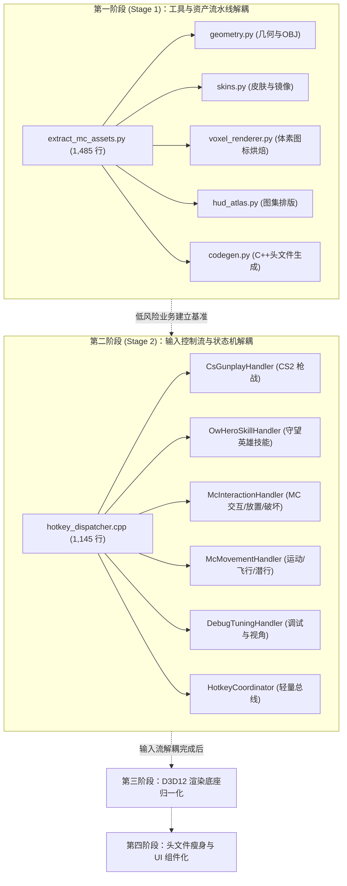
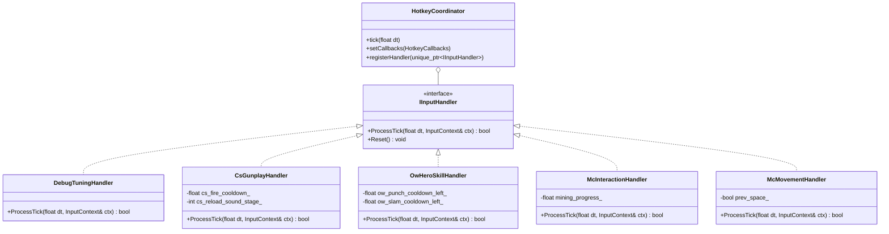

# mc-core 核心模块重构交接文档 (Stage 1 & Stage 2)

> **版本**：v1.0  
> **适用范围**：`mc-core` 子系统大文件治理（排除 `sekiro` 模块及三方依赖）  
> **核心原则**：保持外部 API / ABI 零破坏、测试先行 (TDD)、职责单一 (SRP)、高内聚低耦合。

---

## 目录
1. [重构总体背景与阶段规划](#1-重构总体背景与阶段规划)
2. [第一阶段：资产与工具管线重构 (Stage 1: Asset Pipeline)](#2-第一阶段资产与工具管线重构-stage-1-asset-pipeline)
   - 2.1 现状与痛点诊断
   - 2.2 目标架构设计与目录结构
   - 2.3 细分模块拆解明细
   - 2.4 测试验证与防退化策略
3. [第二阶段：输入分发器状态机解耦 (Stage 2: Hotkey Dispatcher)](#3-第二阶段输入分发器状态机解耦-stage-2-hotkey-dispatcher)
   - 3.1 现状与痛点诊断（上帝对象分析）
   - 3.2 目标架构设计（责任链与子域处理器）
   - 3.3 领域处理器划分与职责矩阵
   - 3.4 回调接口与宿主兼容性保障
   - 3.5 自动化测试防线与验证
4. [重构执行 SOP 与验收铁律](#4-重构执行-sop-与验收铁律)

---

## 1. 重构总体背景与阶段规划

经过全项目大文件扫描，`mc-core` 积累了数个超过 1,000 行的“单体文件（God Files）”。这些文件将多种完全异构的领域逻辑（如 D3D12 渲染状态机、Windows 原始输入捕获、Minecraft 原生规则、CS2 枪械弹道、守望英雄技能时序、Python 离线网格生成）紧密揉捏在单函数或单文件中。

为降低认知负担并规避回归风险，重构分为四个阶段。**本交接文档重点指导前两个阶段的落地实施：**



---

## 2. 第一阶段：资产与工具管线重构 (Stage 1: Asset Pipeline)

### 2.1 现状与痛点诊断
* **目标文件**：[`mc-core/tools/extract_mc_assets.py`](file:///D:/code/universal-modder/mc-core/tools/extract_mc_assets.py)（**1,485 行**，1,270 行有效代码）
* **关联测试**：[`mc-core/tests/test_extract_assets.py`](file:///D:/code/universal-modder/mc-core/tests/test_extract_assets.py)（**940 行**，包含 42 个单元测试）
* **核心痛点**：
  1. **混合多种数据流**：同一个脚本内混杂了 Minecraft Java Client JAR 解析、Bedrock 1.8/1.12 骨骼模型 JSON 解析、OBJ 3D 模型生成、Pillow 图像像素操作、以及 C++ 代码生成的全部逻辑。
  2. **硬编码常量泛滥**：头部 `PARTS`、`ATLAS_ENTRIES` 等全局常量跨越几百行，缺乏模型驱动的强类型数据类。
  3. **单元测试难以局部运行**：任何针对皮肤算法的改动，必须连同庞大的图集打包逻辑一起加载。

### 2.2 目标架构设计与目录结构
将单文件拆解为 Python 模块包，重构后的目录位于 [`mc-core/tools/asset_pipeline/`](file:///D:/code/universal-modder/mc-core/tools/)：

```text
mc-core/tools/
├── extract_mc_assets.py          # 顶层入口薄壳 (Facade CLI，保持向后兼容)
└── asset_pipeline/               # 核心解耦模块包
    ├── __init__.py
    ├── core/
    │   ├── constants.py          # 骨骼部件定义 (PARTS)、方块面定义等
    │   └── types.py              # 数据模型 (Face, Mesh, BoundingBox 等)
    ├── geometry/
    │   ├── cuboid.py             # 立方体与网格组装逻辑
    │   ├── bedrock_parser.py     # Bedrock 1.8 / 1.12 geometry.json 解析器
    │   └── obj_exporter.py       # Wavefront OBJ 序列化器
    ├── textures/
    │   ├── skins.py              # Steve 皮肤、怪物皮肤、左肢镜像逻辑
    │   └── voxel_renderer.py     # 等轴三维方块图标光照烘焙与着色
    ├── atlas/
    │   ├── hud_atlas.py          # 2D HUD Atlas 排版与像素拷贝
    │   └── builder.py            # 图集拼装与溢出检测
    └── codegen/
        └── header_writer.py      # C++ 结构体与图集头文件生成器
```

### 2.3 细分模块拆解明细

| 模块名称 | 承接的原函数列表 | 职责边界 |
| :--- | :--- | :--- |
| **`geometry`** | `cuboid()`, `mesh_from_faces()`, `export_obj()`, `parse_geometry_json()`, `_cube_faces_bedrock()`, `build_geometry_mesh()` | 负责 3D 拓扑结构计算与 OBJ 文本流格式化，纯函数式设计，禁止任何 PIL 图像依赖 |
| **`textures.skins`** | `export_steve_skin()`, `_limb_rects()`, `mirror_empty_left_limbs()`, `export_mob_skin()` | 负责 64x32 到 64x64 骨骼贴图处理、手臂腿部镜像、Alpha 通道校验 |
| **`textures.voxel_renderer`**| `_shade()`, `_multiply_tint()`, `_tint()`, `_paste_face()`, `isometric_block_icon()`, `build_cube_block()` | 负责方块在 2.5D GUI 槽位中的光照明暗计算、草方块/树叶着色乘法与投影变换 |
| **`atlas.hud_atlas`** | `_fit_exact()`, `_read_real_hud_sprite()`, `build_hud_atlas()`, `_atlas_png()` | 负责拼接合成台、快捷栏、经验条、心形血条、准星的图集纹理 |
| **`codegen.header_writer`** | `export_hud_atlas_header()`, `export_adapter_atlas_header()` | 负责产出 C++ 代码头文件，必须保证与老代码生成的字符级对齐 |

### 2.4 测试验证与防退化策略
* **测试守护网**：重构前需确保所有 42 个用例处于绿色状态。执行命令：
  ```bash
  pytest mc-core/tests/test_extract_assets.py -v
  ```
* **CLI 兼容性约束**：[`tools/extract_mc_assets.py`](file:///D:/code/universal-modder/mc-core/tools/extract_mc_assets.py) 必须作为 CLI 入口保留，支持 `argparse` 参数完全透传给 `asset_pipeline`。
* **头文件二进制对比**：测试套件中的 `test_committed_generated_headers_match_the_tool_output` 会校验生成的 `.hpp` 是否与 Git 仓库中既有头文件逐字节匹配，重构时严禁擅自修改排版格式。

---

## 3. 第二阶段：输入分发器状态机解耦 (Stage 2: Hotkey Dispatcher)

### 3.1 现状与痛点诊断（上帝对象分析）
* **目标文件**：
  * 实现：[`mc-core/adapters/eldenring/src/input/hotkey_dispatcher.cpp`](file:///D:/code/universal-modder/mc-core/adapters/eldenring/src/input/hotkey_dispatcher.cpp)（**1,145 行**）
  * 头文件：[`mc-core/adapters/eldenring/include/eldenring_hotkey_dispatcher.hpp`](file:///D:/code/universal-modder/mc-core/adapters/eldenring/include/eldenring_hotkey_dispatcher.hpp)
* **关联测试**：[`mc-core/tests/test_eldenring_hotkey_dispatcher.cpp`](file:///D:/code/universal-modder/mc-core/tests/test_eldenring_hotkey_dispatcher.cpp)（**1,251 行**）
* **核心痛点**：
  1. **巨型函数 `tick(float dt)`**：近 1,000 行的分支嵌套，包含了大量状态计时器更新、边沿触发判断、武器连发与技能后坐力计算。
  2. **状态变量爆炸**：类内维护了 30 余个独立标志位（如 `prev8_`, `prev_ow_e_`, `cs_fire_cooldown_`, `ow_hitstop_left_` 等），不同游戏模组（CS / OW / 原版 MC）的状态相互交叉污染。
  3. **可维护性极差**：调整一次 CS 武器切换后坐力判定，极易意外打断 MC 右键防守或挖掘的长按逻辑。

### 3.2 目标架构设计（责任链与子域处理器）
采用**责任链模式 (Chain of Responsibility) + 子域处理器 (Domain Handlers)**，将 `HotkeyDispatcher` 重构为轻量级的调度协调器 (`HotkeyCoordinator`)。



### 3.3 领域处理器划分与职责矩阵

| 子处理器 (Handler) | 职责与状态隔离 | 拥有的状态字段 |
| :--- | :--- | :--- |
| **`DebugTuningHandler`** | 处理 F1/F2/F3、截图、录制、CS/OW 视口偏移调优按键 (`[` `]` `,` `.` 等) | `prev_f1_`, `prev_f2_`, `prev_f3_`, `prev_csview_keys_`, `prev_owview_keys_` |
| **`CsGunplayHandler`** | 处理 CS 武器射击（左键点射/连发）、换弹 R 键阶段音效状态机、后坐力恢复计时 | `cs_fire_cooldown_`, `cs_since_shot_`, `cs_reload_sound_stage_`, `prev_reload_r_` |
| **`OwHeroSkillHandler`**| 处理末日铁拳 E 技能（上勾拳）、Shift/Q（砸地）、右键蓄力冲拳与打击硬直 (hitstop) | `ow_fire_cooldown_`, `ow_punch_cooldown_left_`, `ow_uppercut_cooldown_left_`, `ow_slam_cooldown_left_`, `ow_hitstop_left_` |
| **`McInteractionHandler`**| 判定 Minecraft 核心操作：长按挖掘、右键放方块/刷怪蛋/弓弩拉弦、TNT/苦力怕打火石触发 | 滚轮切槽、数字键 1~9 快捷栏选择 (`prev_digit_`)、左右键长按与单击状态 |
| **`McMovementHandler`** | 双击空格开启/关闭创造模式飞行、潜行按键下沉、冲刺按键前冲判定 | `prev_space_`, 飞行双击间隔计时器 |

### 3.4 回调接口与宿主兼容性保障
* **`HotkeyCallbacks` 保持稳定**：该结构体被老头环宿主注入层深度依赖，重构时**严禁删除或重命名已有 `std::function` 字段**。
* **输入上下文聚合**：构造一个轻量级结构体 `InputTickContext`，包含 `dt`、当前按键边沿状态与只读的 `HotkeyCallbacks&`，在各个子 Handler 之间流转。

### 3.5 自动化测试防线与验证
* **测试编译与运行**：
  * 测试源码位置：[`mc-core/tests/test_eldenring_hotkey_dispatcher.cpp`](file:///D:/code/universal-modder/mc-core/tests/test_eldenring_hotkey_dispatcher.cpp)
  * 该测试文件模拟了完备的 Mock 键盘、鼠标按键、计时器推移与回调触发断言。
* **重构测试红线 (TDD 约束)**：
  1. 任何处理器的拆分必须先保证已有测试 100% 运行通过。
  2. 针对拆分出的 `CsGunplayHandler` 和 `OwHeroSkillHandler`，必须保留对打击后坐力与冷却时序的单调递减断言。

---

## 4. 重构执行 SOP 与验收铁律

为保证项目稳定演进，承接重构任务的工程师或 Agent 必须遵循以下铁律：

1. **Git 分支规范**：
   - 第一阶段在 `feature/refactor-asset-pipeline` 分支进行。
   - 第二阶段在 `feature/refactor-hotkey-dispatcher` 分支进行。
   - 严禁直接提交至主干分支。
2. **零内联脚本规范**：
   - 严禁使用诸如 `python -c` 或终端管道执行临时探测；所有探测与校验必须沉淀为正规测试或可复现的验证脚本。
3. **分步执行流水线 (Red-Green Checklist)**：
   - [ ] **Step 1（基准回归）**：在未做任何修改前，运行全量现有测试并记录测试报告（确保 Exit Code 为 0）。
   - [ ] **Step 2（目录与接口搭建）**：创建新模块目录，搭建接口类与空实现。
   - [ ] **Step 3（逐块搬迁与委托）**：将原函数逻辑逐一抽取至新模块，原单体类作为委托外壳 (Delegating Wrapper) 调用新模块。
   - [ ] **Step 4（测试覆盖检查）**：运行自动化测试，验证行为完全一致。
   - [ ] **Step 5（外壳精简与代码清理）**：清理废弃变量与死代码，格式化代码风格。
4. **交付物验收标准**：
   - 编译警告零增加（`-Wall -Wextra` 合规）。
   - 测试通过率 100%（`test_extract_assets.py` 42/42 通过；`test_eldenring_hotkey_dispatcher.cpp` 全套断言通过）。
   - 单文件行数全面回落至 500 行以内。

---

## 5. 验收记录（2026-11-02，Windows 11 + VS 2022 + CMake 3.28.2）

两个重构提交已在 `verify/refactor-stage-1-2` 分支上，验收期间**未修改任何源码**。

### 5.1 Python 资产管线

| 检查项 | 命令 | 结果 |
| :--- | :--- | :--- |
| 资产测试 | `uv run --with pillow --with pytest python -m pytest tests/test_extract_assets.py -q` | **42 passed** |
| 文档规定命令 | `uv run --with pillow --with pytest python -m pytest tests/test_extract_assets.py tests/test_adapter_standards.py -q` | **55 passed** |
| 全量 Python | `uv run --with pillow --with pytest python -m pytest tests -q` | **114 passed, 1 skipped** |
| 真实 jar 端到端 | `python tools/extract_mc_assets.py --client-jar D:\game\sekiro\build\mc_client_1.21.8.jar --export-hud-atlas --export-steve-skin --export-all-mobs ...` | 133 UV regions；Steve + zombie/creeper/skeleton 皮肤正常导出 |
| 真实图集断言 | `python tools/inspect_atlas_regions.py <atlas>` | `entity_shield` **716** 实心像素（要求 716），`item_shield` **144**（要求 ≥140） |
| 头文件逐字节比对 | `test_committed_generated_headers_match_the_tool_output` | 通过（`hud_atlas.hpp` / `sekiro_hud_atlas.hpp` / 占位 PNG 全部一致） |

### 5.2 C++ 输入分发器与构建变体

`cmake --build <dir> --config RelWithDebInfo --parallel`，MSVC `/W4 /WX`。

| 构建目录 | 模式开关 (MC/CS/OW) | 测试结果 |
| :--- | :--- | :--- |
| `build` | ON/ON/ON | 1401 tests，**1400 passed, 1 skipped** |
| `build_modes/mc+cs+ow` | ON/ON/ON | 1401 tests，**1400 passed, 1 skipped** |
| `build_pure_mc` | ON/OFF/ON | 1335 tests，**1334 passed, 1 skipped** |
| `build_ow_only` | OFF/OFF/ON | 1335 tests，**1334 passed, 1 skipped** |
| `build_modes/ow` | OFF/OFF/ON | 1335 tests，**1334 passed, 1 skipped** |
| `build_cs_only` | OFF/ON/OFF | **1357 passed** |
| `build_mc_only` | ON/OFF/OFF | **1291 passed** |

- 跳过项均为 `OwViewmodelTest.ParsesTheShippedAssetWhenProvided`（需要外部 OW 资产，属预期跳过）。
- 编译器 **0 warning / 0 error**。唯一的链接器告警 `LNK4197`（`sekiro_adapter` 重复导出 `DirectInput8Create`）来自未改动的 `adapters/sekiro`，与本次重构无关。
- 行数：`extract_mc_assets.py` 139 行；`asset_pipeline` 最大文件 433 行；`hotkey_dispatcher.cpp` 279 行；各 handler 85–308 行。**全部 < 500 行**。

### 5.3 行为等价性人工核对

- Python：逐函数 diff 旧单文件与新模块，除注释空格与 `_atlas_png` → `atlas_png` 重命名外无逻辑差异；`main()` 的 argparse 与执行顺序完全一致。
- C++：`HotkeyDispatcher::tick` 的调用顺序与原 1,145 行版本逐段对齐（sprint → footsteps → regen → subsystem → control plan → 右键级联 OW→CS→MC → bow → shield → wheel → action timers → F/数字/R → suppress → jump → 左键 → OW/CS attack → melee → debug）；`resetKeyStates()` 覆盖的字段与原实现一致；`HotkeyCallbacks` 字段与顺序未变。
- 新增的独立状态副本（`prev_digit_`、`prev_gameplay_f_`）在原实现中由 CS/MC 共用，但因两模式互斥且每 tick 同步更新，语义等价。

### 5.4 未完成项

- **实机验证未做**：需要把 `dinput8.dll` 部署到游戏目录并在真实游戏中跑 MC/CS/OW 三模式；按仓库规则，部署与游戏内确认必须由用户执行/确认，本次验收只到构建与自动化测试层。
